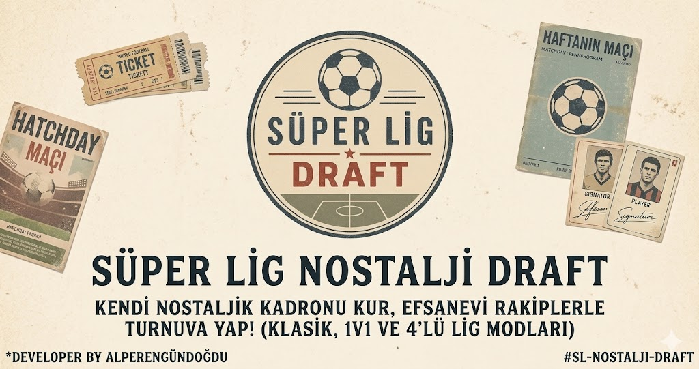

# ⚽ Süper Lig Nostalji Draft & Kulüp Tycoon

<div align="center">



**Türk futbol tarihinin unutulmaz 2004–2026 dönemi efsanelerini yeniden keşfedin, rüya kadronuzu kurun, izometrik kulüp tesislerinizi inşa edin ve arkadaşlarınızla canlı derbi heyecanını yaşayın!**

[](https://superligdraft.site/)
[](https://developer.mozilla.org/en-US/docs/Web/JavaScript)
[](https://www.php.net/)
[](https://developer.mozilla.org/)
[](LICENSE)

</div>

---

## 📖 Proje Hakkında

**Süper Lig Nostalji Draft**, Türk futbolunun 2000'li yıllardan günümüze uzanan altın çağını (Galatasaray, Fenerbahçe, Beşiktaş, Trabzonspor ve Anadolu efsaneleri) interaktif bir futbol strateji oyunu ve kulüp simülasyonu olarak sunan kapsamlı bir web platformudur.

Oyun; Alex de Souza'nın kıl payı paslarından Hagi'nin füze şutlarına, Muslera'nın kritik kurtarışlarından Sneijder'ın derbi gollerine ve Quaresma'nın trivelalarına kadar yüzlerce efsane futbolcuyu zengin bir veritabanında toplar.

Nostaljik retro gazete tasarımı ile modern FIFA FUT kart estetiğini harmanlayan arayüzü, 2D izometrik şehir/tesis kurma motoru ve gerçek zamanlı multiplayer oyun altyapısıyla benzersiz bir futbol deneyimi sunar.

---

## ✨ Temel Özellikler & Oyun Modları

```
Süper Lig Nostalji Draft
 ├── 🏆 Klasik Turnuva Modu (Tek Oyunculu)
 ├── ⚔️ 2 Oyunculu Derbi (1v1 Canlı Multiplayer)
 ├── 🏙️ Kulüp Tycoon & Şehir Simülasyonu (İzometrik Canvas Engine)
 ├── 📦 FIFA FUT Tarzı 3D Paket Açılışı & Transfer Pazarı
 └── 🏛️ Kupa Müzesi & Retro Kadro Posteri Oluşturucu
```

### 1. 🏆 Klasik Turnuva Modu (Singleplayer)
- **Taktiksel Diziliş Seçimi**: 4-4-2, 4-3-3, 3-5-2, 4-2-3-1 gibi taktiksel varyasyonlar.
- **Rastgele Draft Mekaniği**: Her mevkii için nostalji havuzundan gelen 5 efsane futbolcu arasından en uygununu seçme.
- **Dinamik Reyting & Kimya**: Doğru mevkii uyumu ve takım kimyası hesaplaması.
- **16 Takımlı Eliminasyon Turnuvası**: Son 16 -> Çeyrek Final -> Yarı Final -> Büyük Final.
- **Gelişmiş Maç Motoru**: Canlı spiker anlatımı, şut/pozisyon simülasyonu, VAR kararları, uzatmalar ve penaltı atışları.

### 2. ⚔️ 1v1 Derbi Modu (Canlı Multiplayer)
- 6 haneli benzersiz **Oda Kodu** ile anında arkadaş daveti.
- Karşılıklı canlı draft aşaması ve gerçek zamanlı senkronizasyon.
- Poisson dağılımı temelli adil derbi simülasyonu ve beraberlikte seri penaltı atışları.

### 3. 🏙️ Kulüp Tycoon & İzometrik Şehir Simülasyonu (`city_builder.js`)
- **Özel 2D İzometrik Canvas Motoru**: Gerçekçi diorama zemin, katman derinlik sıralaması (*depth sorting*), dinamik gölgelendirmeler ve çim dokuları.
- **Tesis İnşaatı**: Stadyum, Antrenman Kompleksi, Gençlik Akademisi, Scout & Yetenek Laboratuvarı, Kulüp Müzesi, Medya Kulesi, Sporcu Oteli, Bistro ve Heykeller.
- **Altyapı & Peyzaj**: Asfalt bulvarlar, taş kaldırımlar, parsel genişletme arazileri.
- **Dokunmatik & Fare Desteği**: Akıcı pan/zoom kontrolleri, interaktif yerleştirme ve yıkım modları.

### 5. 📦 3D Paket Açılışı & Transfer Pazarı (`tycoon.js`)
- **FUT Tarzı Paketler**: Başlangıç Kulüp Paketi, Bronz, Gümüş, Altın Süper Lig ve Özel Efsane Paketleri.
- **3D Kart Animasyonları**: Özel ışık efektleri ve açılış heyecanı.
- **Dinamik Transfer Pazarı**: Oyuncu alım-satımı, kulüp bütçe yönetimi ve scout keşifleri.
- **Online Liderlik Tablosu**: En yüksek kulüp değerine ve kadro gücüne sahip menajerler sıralaması.

### 6. 🏛️ Kupa Müzesi & Retro Poster Arşivi
- Kazanılan tüm şampiyonluk kupalarının ve kurulan rüya kadroların kaydedildiği müze odası.
- Yüksek çözünürlüklü retro gazete kupürü / maç posteri oluşturma ve indirme özelliği.

---

## 🛠️ Teknoloji Yığını (Tech Stack)

| Alan | Teknoloji | Açıklama |
|---|---|---|
| **Frontend** | Vanilla JavaScript (ES6+) | Framework bağımsız, yüksek performanslı DOM & State yönetimi |
| **Grafik & Render** | HTML5 Canvas API | 2D İzometrik projeksiyon ve diorama şehir simülasyon motoru |
| **Ses & Efektler** | Web Audio API | Dinamik 8-bit / retro ses sentezleyici ve ambiyans efektleri |
| **Stil & Arayüz** | Vanilla CSS3 | Modern glassmorphism, retro gazete tipografisi, responsive düzen |
| **Backend API** | PHP 7.4+ / 8.x | JSON tabanlı lobi yönetimi, Poisson maç motoru ve REST endpointleri |
| **Veritabanı / Depolama** | JSON & LocalStorage | Dosya tabanlı hafif oda kayıtları (`rooms/`) ve yerel istemci önbelleği |
| **İkon & Fontlar** | FontAwesome 6, Google Fonts | *Bebas Neue*, *Montserrat*, *Courier Prime*, *Outfit* |

---

## 📂 Proje Dizin Yapısı

```bash
draftsite/
├── index.html                  # Ana oyun arayüzü, menüler, draft ekranları ve SEO içeriği
├── style.css                   # Kapsamlı stil dosyası, animasyonlar ve responsive tasarım
├── game.js                     # Turnuva mantığı, draft motoru, maç & penaltı simülasyonu
├── tycoon.js                   # Tycoon kariyer modu, paket açılışı, transfer pazarı & lig
├── city_builder.js             # İzometrik Canvas şehir simülasyonu ve tesis inşa motoru
├── api.php                     # Multiplayer odaları, lig simülatörü ve liderlik tablosu API'si
├── index.php                   # Dinamik sunucu yönlendirmesi
├── super_lig_nostalji_data.json# Efsane futbolcular ve takım istatistikleri veri havuzu
├── tycoon_players.json         # Tycoon & paket açılış modu için genişletilmiş oyuncu veritabanı
├── tycoon_leaderboard.json     # Tycoon online liderlik tablosu kayıtları
├── rooms/                      # Canlı multiplayer 1v1 oda JSON verileri
├── assets/                     # Sosyal medya görselleri (Open Graph, afişler)
├── icon-assets/                # Çeşitli arayüz ikonları ve rozetler
├── images/                     # Futbolcu kart görselleri ve kulüp logoları
├── gizlilik-politikasi.html    # Gizlilik politikası sayfası
├── kullanim-sartlari.html      # Kullanım şartları sayfası
├── sitemap.xml & robots.txt    # SEO yapılandırma dosyaları
└── favicon.png                 # Site favicon ikonu
```

---

## 🚀 Kurulum ve Yerel Çalıştırma (Getting Started)

Projeyi yerel bilgisayarınızda çalıştırmak için aşağıdaki adımları takip edebilirsiniz:

### Gereksinimler
- **PHP 7.4+** veya **PHP 8.x** (Multiplayer lobi ve API işlevleri için gereklidir)
- Herhangi bir modern web tarayıcısı (Chrome, Safari, Edge, Firefox vb.)

### 1. Projeyi Klonlayın
```bash
git clone https://github.com/alpereng77/superligdraft-site.git
cd superligdraft-site
```

### 2. İzinleri Ayarlayın (Linux / macOS)
Multiplayer odalarının ve liderlik tablosunun JSON dosyalarına yazılabilmesi için `rooms/` dizinine yazma izni verin:
```bash
chmod -R 775 rooms tycoon_leaderboard.json
```

### 3. PHP Dahili Geliştirme Sunucusunu Başlatın
```bash
php -S localhost:8000
```

### 4. Tarayıcınızda Açın
Tarayıcınızın adres çubuğuna gidin:
```
http://localhost:8000
```

*(Opsiyonel olarak projeyi **XAMPP**, **WampServer**, **Laragon** veya **Nginx/Apache** altında doğrudan barındırabilirsiniz.)*

---

## 🧮 Simülasyon & Matematiksel Mekanikler

### İzometrik Projeksiyon Dönüşümü (`city_builder.js`)
Şehir simülatöründe ızgara koordinatları $(col, row)$ ekrandaki izometrik koordinatlara $(x_{iso}, y_{iso})$ şu formülle dönüştürülür:

$$x_{iso} = (col - row) \cdot \frac{TILE\_WIDTH}{2}$$

$$y_{iso} = (col + row) \cdot \frac{TILE\_HEIGHT}{2}$$

### Maç Simülasyonu & Poisson Dağılımı (`api.php` & `game.js`)
Takımların güç farkları ($\Delta OVR = OVR_{ev} - OVR_{dep}$) üzerinden her iki takım için beklenen gol beklentisi ($\lambda$) hesaplanır ve Poisson dağılımı ile maç skoru üretilir:

$$P(X = k) = \frac{\lambda^k e^{-\lambda}}{k!}$$

---

## 👨‍💻 Geliştirici

- **Alperen Gündoğdu**
- GitHub: [@AlperenGundogdu](https://github.com/AlperenGundogdu)
- Web: [superligdraft.site](https://superligdraft.site)

---

## 📄 Lisans

Bu proje [MIT Lisansı](LICENSE) altında lisanslanmıştır. Detaylar için lisans dosyasına göz atabilirsiniz.
